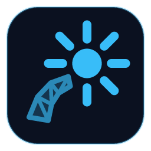

<div align="center">
  
  <h1>Flare Navgen</h1>
  <p>Pick the tiles. Watch them build. Ship the navmesh.</p>
  <p>
    <a href="https://github.com/CallMeLewis/flare-navgen/releases/latest"></a>
    <a href="https://github.com/CallMeLewis/flare-navgen/actions/workflows/ci.yml"></a>
  </p>
</div>

Flare Navgen builds the `.nm` navigation meshes DayZ loads, for any terrain, from the world geometry DayZDiag's data
server sends. Connect to the server, pick the tiles on a map of the world and watch them build live. It's a desktop app
for Windows, with a command-line engine, `dznav`, underneath.

## Download

Get the latest version from the **[releases page](https://github.com/CallMeLewis/flare-navgen/releases/latest)**: run
the installer. The app keeps itself up to date after that. See what changed in each version in
[CHANGELOG.md](CHANGELOG.md).

You need DayZ, whose DayZDiag serves the world geometry, and an empty mission for your terrain (see
[Generating a navmesh](#generating-a-navmesh)).

## What it does

- Builds the whole world or just a tile range, on every core, and can patch a regenerated area into an existing
  navmesh.
- Reproduces DayZ's generation pipeline: Recast with DayZ's changes, door parts, tree obstacles, jump/climb links, the
  isolated-island filter and DayZ's Detour tile format. Given the same geometry, its tiles are byte-identical to
  reference navmeshes ([docs/validation.md](docs/validation.md)).
- Doesn't crash on coastal tiles with trees and doors, bad files or bad network input
  ([docs/crashes.md](docs/crashes.md)).
- Stops and resumes a run, and saves what it has built if DayZDiag dies mid-run.
- Inspects a `.nm` tile by tile, and verifies, compares or merges files.
- Fetches from several DayZDiag machines at once, since fetching is usually the bottleneck.
- Light and dark themes, an interface size, and stable and beta update channels.

## Generating a navmesh

1. Prepare an empty mission for your terrain and a server config pointing at it, as described in
   the [BI wiki](https://community.bistudio.com/wiki/DayZ:Generating_navigation_mesh).
2. Start the data server:

   ```sh
   DayZDiag_x64 -server -mod=<your mods> -startNavmeshDataServer -config=serverDZ_navmesh.cfg
   ```

3. Open Flare Navgen, connect to the data server and press Start. Or, from the command line:

   ```sh
   dznav generate navmesh.nm                      # whole world
   dznav generate patch.nm --range 0 80 326 89    # a tile range
   dznav generate navmesh.nm --base old.nm --range 100 100 120 120   # regenerate part of a map
   ```

The data server listens on port 36533 and serves one client at a time. Fetching from it is usually
the bottleneck; to go faster, run DayZDiag on several machines and list them all:
`--server 192.168.1.10,192.168.1.11`.

If DayZDiag dies mid-run, restart it and resume: `--base navmesh.nm --skip-existing`
(`--checkpoint 5000` saves progress every 5000 tiles). Ctrl+C stops a run and saves what it has
built, so you can resume the same way.

Other options: `--threads N`, `--record geometry.dzgeo` (save the fetched geometry so you can
regenerate offline with `--capture`), `--sea-level M` (the server sends the live tide value, so
pin it for reproducible output), `--doors closed|open|enabled`, `--no-links`,
`--no-island-filter`, `--seed x y z`.

## Other commands

```sh
dznav info navmesh.nm                       # summary: tiles, polys, links, areas, flags
dznav tile navmesh.nm 205 41                # dump one tile (polys, jump links, doors, obstacles)
dznav render navmesh.nm out.png 10150 1950 10650 2450 4   # top-down preview, 4 px/m
dznav diff a.nm b.nm 20                     # tile-by-tile comparison
dznav verify reference.nm ours.nm [--ignore-order]        # byte-compare tiles (docs/validation.md)
dznav merge base.nm patch.nm out.nm [x0 z0 x1 z1]         # replace tiles and relink the seams
dznav islands in.nm out.nm 7500 0 7500      # re-run the isolated-island filter
dznav probe [host] [x z]                    # data server world params / one tile
dznav capture out.dzgeo x0 z0 x1 z1         # save tile geometry
dznav replay-server out.dzgeo --bind 127.0.0.2 --crop --once
                                            # serve saved geometry to another client
                                            # (docs/validation.md)
dznav roundtrip navmesh.nm                  # parse + re-serialize, check byte equality
```

Add `--json` to `generate`, `probe`, `capture`, `info`, `tile`, `render`, `verify`, `diff`, `merge`
or `islands` for JSON-lines output: [docs/cli-json.md](docs/cli-json.md).

## Documentation

- [`.nm` file format](docs/format/nm-format.md)
- [Data-server protocol](docs/protocol/data-server.md)
- [Generation pipeline](docs/pipeline.md)
- [Validation](docs/validation.md)
- [Crash fixes](docs/crashes.md)
- [JSON output](docs/cli-json.md)

## Building it yourself

See [docs/development.md](docs/development.md) for building the engine and the app, tests and how releases are made.

## Licence

Flare Navgen is free software under the [GNU General Public License v3](LICENSE). Recast & Detour
(`third_party/recastnavigation`) keep their own zlib licence.

Flare Navgen is an independent project. It is not made or endorsed by Bohemia Interactive. DayZ is a trademark of
Bohemia Interactive a.s.
